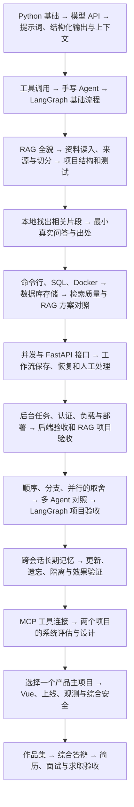

# AI Agent 应用岗 · 依赖驱动内容块

本文件把课程任务按知识依赖组织成内容块。W1–W20 是兼容 tracker、历史证据和算法台账的稳定 ID，不是日历周、完成期限或学习时长；一个内容块可以跨任意数量的日期与 Session。课程状态只读 `tracker/progress.md`，当前入口只读 `tracker/daily-plan.md`。

最后路线校准：2026-09-07。此次学习方法、收藏教材依据和反思见 [评审记录](../resources/learning-method-review-2026-09-07.md)。

## 路线原则

- 主目标是初级/初中级 Agent 应用开发，次目标是大模型应用后端与 RAG/知识库工程，AI 全栈只作邻接优势。
- A4-Gate 已证明 Agent Loop、ReAct、Plan-and-Solve、Reflection、工具边界、停止与受控恢复；后续只迁移和组合这些能力，不换名字重复教学。
- A4 后先接触 LangGraph，再进入 LangChain/RAG；工程基础在两个真实项目需要时即时补齐，不等待完整 BE5 前置课。
- FastAPI 是两个纯 Python 核心的交付层，不是 Agent 编排框架，也不再单独创建聊天玩具。
- LangChain 与 LangGraph 可以互用组件，但两个旗舰必须分别有明确主框架、业务问题、目录、测试和 Gate 证据。
- PostgreSQL + pgvector 是向量检索主线；轻量本地索引只用于理解原理，Qdrant/Milvus 只在 JD 或架构取舍需要时短对照。
- 多 Agent 不自动成为产品默认方案。先建立单 Agent baseline，再在 `S-04` 做最小受控候选实验；是否采用由同集结果和成本决定，没有净收益就保留单 Agent。
- checkpoint/thread state 负责一次工作流的执行状态；`D7-03` 的长期 Memory 负责跨会话事实生命周期。二者不得混称。
- H5 保持可选：只在真实框架问题需要时追一条源码路径，不阻塞主线。
- 用户会一些 Vue，前端不扩成独立主线：先做最小独立复核；真正进入界面任务时，助手可审计许可证、维护状态、依赖和安全风险后组合 GitHub 开源 Vue 骨架。若 G8-Gate 提前采用，用户当场做第三方代码最小准入审核；完整状态/SSE/认证/错误处理和亲自修改能力留到 J11-03。助手搭建不算用户独立掌握证据，也不提前克隆。J11-02 冻结唯一 `product_flagship`，不建设两套正式前端/公网产品链。

## 两个旗舰项目

| 主框架 | 项目 | 规划目录 | 需要证明的核心能力 |
| --- | --- | --- | --- |
| LangChain | 工程文档 RAG 助手 | `code/stage6/engineering_docs_rag/` | Loader/Splitter/Document/metadata、检索、固定两步 RAG、Agentic RAG、引用、权限、评估、API 与部署 |
| LangGraph | 故障诊断与变更评审 Agent | `code/stage8/incident_change_review_agent/` | 显式 State/Node/Edge、route/loop/stop、stream、checkpoint、interrupt/resume、幂等、受控多 Agent、评估与恢复 |

两个项目的交付层统一为：

```text
HTTP / SSE / Auth / Validation / 统一错误返回规则
                       │
                 Application Adapter
              ┌────────┴─────────┐
              │                  │
      LangChain RAG Core   LangGraph Workflow Core
```

## 学习路径总览

下图把同一条依赖路线按可见成果串起来，精确任务与验收仍看下方内容块表。课程状态读取 `progress.md`，当前继续位置读取 `daily-plan.md`；图中位置不表示已经完成，也不新增课程或截止日期。



算法按内容块独立练习；Git/协作证据随真实项目积累；岗位审计按指定内容块独立核查；第二模型适配按挂载条件完成。它们不作为每个小知识点额外叠加的一套作业，具体入口、欠项和验收以各自台账及下方挂载规则为准。

## 内容块顺序

W1–W5 是已发生的历史学习块，精确任务状态和证据仍以 `progress.md` 与历史 daily 为准，不重写历史。

| 内容块 | 依赖驱动任务顺序 | 可验证产物 / 里程碑 |
| --- | --- | --- |
| W1–W3 | Python、LLM API、Prompt、结构化输出 | Python Gate、流式 CLI、结构化输出与上下文实验 |
| W4 | Tool Calling 与算法启动 | T3-Gate；算法首块 4 道新题替代无旧题的复测位 |
| W5 | Agent 基础与 A4-Gate | 手写 Agent Loop、ReAct、Plan-and-Solve、Reflection、正式 14-case Gate |
| W6 | `G8-00`（课程位置：阶段 4.5）；并行开启 `J11-01` 的证据积累与首轮岗位审计 | LangGraph 故障诊断与变更评审 Agent v1：typed state、node/edge、条件路由、工具、停止、stream、测试；这不是直接跳到完整阶段 8。岗位样本不足保持 RETRY 并继续独立补齐，不阻塞已满足技术依赖的 W7/R6-01 |
| W7 | `R6-01 → BE5-01`（同一项目、分别验收） | 助手先给完整可修改的最小场景，讲清 RAG 的用途、资料准备与查询生成两阶段，并核对资料怎样交给模型的理解；按授权固定设计，读入一份 Markdown/TXT 并展示内容和来源，再逐步补 PDF、切分、metadata、去重和文档状态；随后补项目分层、日志、pytest、Ruff 与类型检查 |
| W8 | `R6-02 本地检索切片 → R6-03 最小问答切片 → B0-01 → B0-03 → B0-04 → B0-Gate → BE5-04 → R6-02 剩余标准/S-02` | 先用真实 embedding 找到相关片段，再用真实 DeepSeek 回答一个问题并定位出处、验证无答案例；随后补数据库基础和生产检索。B0-04/Gate 共用一份 Compose/CLI，再迁入旗舰；完成 pgvector、migration、filter、hybrid、rerank 与检索指标 |
| W9 | `R6-03 剩余标准 → S-06` | 承接 W8 已有问答，不重写；补查询改写/拆分、同集固定两步与 Agentic 对照、完整引用/拒答和失败分层，再用真实证据判断 Prompt/RAG/微调怎样选 |
| W10 | `BE5-02 → BE5-03`；`S-01` 可从 provider 边界开始但不阻塞本块 | 两个纯 Python 核心分别接 FastAPI/Pydantic/SSE；timeout、cancel、并发限制、系统出错时怎样返回结果与接口测试；Graph 的 HITL 决策接口留到 G8-03 增量实现 |
| W11 | `G8-01 → G8-02 → G8-03` | LangGraph v2：PostgreSQL 持久 checkpoint、thread 隔离、重启恢复、approve/edit/reject API、幂等副作用和故障注入 |
| W12 | `BE5-05 → BE5-Gate`；第二轮岗位审计；挂载 `J11-07` 早期求职材料校准 | Redis、后台任务、认证、重复提交、负载、CI、Docker、smoke 与生产后端 Gate；复用两个项目，不建第三个教学项目。Gate 后用新增证据校准项目描述和 2–3 条硬门槛已核清岗位的差距，不替代正式岗位审计或提前判 J11-07 PASS |
| W13 | `R6-Gate`；完成 `S-05` 的 RAG/ACL/间接注入切片 | LangChain 工程文档 RAG 旗舰：完整导入/检索/问答/API/权限/评估/部署证据 |
| W14 | `D7-01 → D7-02 → S-04 → G8-Gate` | 先复用 G8-00、BE5-02 与已有旗舰的证据，完成串联、路由、并行的适用条件和取舍回顾，只补 D7-01 未证明的判断；随后以单 Agent baseline 冻结协作实验问题、预算与回退条件，用最小候选实验完成交接格式、共享/私有 state、预算/停止/升级与同集对照；默认采用取决于实测净收益。G8-Gate 复用协作实验并验收 FastAPI/SSE 与可观察状态输出，可用 curl/调试页或启动后引入的已审计 Vue 薄界面；完整 Vue 掌握仍在 J11-03 复核 |
| W15 | `D7-03 → D7-Gate`；完成 `S-05` 的 Memory/PII/poisoning 切片 | 复用前面的模式取舍证据，在已有项目完成跨会话 Memory CRUD/TTL/provenance/delete/隔离/poisoning 与无 Memory 对照，再做设计模式验收，不另建玩具 |
| W16 | `M9-01 → M9-02 → M9-03 → M9-Gate`；第三轮岗位审计 | MCP 与外部工具连接、授权、断连与审计证据；补齐 `S-05` 的 MCP 授权/恶意 server 切片 |
| W17 | `E10-01 → E10-02` | 一套共享 Eval Harness + 两个领域 adapter；两个旗舰分别完成 baseline/candidate、回归门禁和系统设计包，不复制两套评估平台 |
| W18 | `J11-02 → J11-03 → J11-04 → J11-05 → S-05 正式收口`；并行补齐待完成 `S-01` | 先冻结唯一 `product_flagship`，再为它完成产品 API、Vue、公网部署和产品级观测；另一旗舰保留可复现 API/demo、容器与 E10 评估，随后收口权限、恢复、幂等、SLO、成本、回滚与生产事故闭环。缺少第二 provider 不阻塞这些产品化任务，但 FINAL 前仍须完成 S-01 |
| W19 | `J11-01 收口 → J11-06 → FINAL-Gate → J11-07 → J11-08 → J11-Gate`；第四轮岗位审计 | 先完成作品工程化、部署和持续评估，再做综合答辩；随后收束作品集、简历、模拟面试与正式岗位证据 |
| W20 | 证据债务、算法债务、交叉复核与投递前收口 | 不新增课程主题，只闭合既有缺口并稳定投递 |

## 挂载任务与状态写回

- `R6-02/03` 的提前切片只证明当前已运行的行为，完整标准未齐仍为 `DOING`。每次只推进一个当前检查点；切换到下一依赖时记录已有证据、剩余标准和恢复条件，依靠同一旗舰复用结果，不新增任务 ID 或第二套 demo。R6-02 在 BE5-04 后收口，R6-03 在 W9 收口；W8 算法配额只计算一次，不随内部切片增加。embedding 在该切片启动时验证可用的真实本地模型或服务，不能把 DeepSeek 聊天接口当作 embedding 接口。
- `J11-01` 从 W6 累计真实 README、分支/PR/CI/review/revert 和 AI 协作审查，最晚在 `J11-06` 前收口。接手陌生模块、依赖版本候选评估和 J11-06 反馈迭代复用已有实质性改动，不重复建设项目或 PR。
- `J11-07` 在 BE5-Gate 后按该任务已有标准做一次早期材料校准：复用新项目证据和已核清硬门槛的 2–3 条岗位，仅形成项目描述与差距记录；若当前正式岗位样本已包含合适条目，直接复用，不再重复采样。外部资料不足时记录缺口并行补齐，不阻塞技术主线；局部结果不替代 W12 正式审计，J11-07 完整验收仍留到 W19。
- `S-01` 在 `BE5-02` 出现 provider 边界时核查真实第二 provider 的凭据或本地运行条件；可启动的切片随项目推进。条件未具备时记录具体缺口并保留 `TODO/DOING`，不阻塞早期 BE5/R6/G8 Gate 或 J11-02 产品化；最晚在 `FINAL-Gate` 前完成真实第二 provider 对照，mock 不替代真实调用。
- `S-02` 与 `R6-02` 共用同一覆盖图、作答与运行证据，分别核验后写回两个状态；达标就当场收口，不重新出第二套题。若只缺集成切片，明确留至 `R6-Gate`；Gate 只检查新增/变化部分。
- `S-05` 逐步累计 A4 安全、R6 权限/间接注入、D7-03 Memory/PII/poisoning、M9 授权/恶意 server 与 J11 综合回归；全部切片齐全后，在 `J11-06/FINAL-Gate` 前独立正式判定。
- `S-06` 在 `R6-03` 真实对照后复用同一项目证据回答 Prompt/RAG/微调选型，再单独写回状态。
- `H5-01` 只按真实 debug 触发单链路源码追踪，不阻塞主队列；已有等价维护证据可用于 J11-01。
- W6/W12/W16/W19 岗位审计与课程 Session 分开，状态以 `job-readiness.md` 为准；不足时独立补齐，后续审计复查未关闭原因并保留各自快照，不因写进路线就视为完成。

## 多 Agent 与长期 Memory 的准入边界

### `S-04` 受控多 Agent

- 先在同一故障诊断数据集上保留单 Agent baseline。D7-02 冻结待验证的问题、角色、预算与回退条件，S-04 在现有项目实验分支引入 supervisor/subagent、handoff 或 router 中一种最小候选模式；实验本身不等于产品准入，也不以预先证明有收益为前提。
- handoff 必须使用带类型约束的交接格式，明确输入、输出、证据引用、失败、超时和所有权；共享 state 与私有 context 分开。
- 必须有 `max_handoffs`、总 step/成本预算、停止与人工升级；worker 不能绕过工具权限和副作用确认。
- 比较任务成功、遗漏/冲突、延迟、token/成本与 trace 可诊断性。没有净收益就回退单 Agent，不因术语热度保留复杂度。

### `D7-03` 长期 Memory

- 覆盖跨会话显式写入、检索注入、更新、冲突、TTL、删除/忘记、provenance、租户隔离、PII 与 poisoning。
- PostgreSQL 是长期事实源；Redis 只作缓存。未受信工具输出或 RAG 文本不得自动晋升为长期记忆。
- 用同一数据集比较有/无 Memory 的任务成功、误记、遗漏、延迟和成本；checkpoint 的恢复证据不能冒充长期 Memory 证据。

## 算法保护项

- W4–W20 共 17 个内容块，最低累计 **52 道新题**。
- 每个内容块固定 `3 新 + 1 旧错题`；W4 因无旧题，以第 4 道新题替代。
- 算法以独立 Session 推进，一个内容块跨日不重置或增加配额。债务先清：旧债未清时不启动下一完整 `3+1`；旧题按 `weak-points.md` 的相关活跃/到期目标选择，优先占现有旧题席位，不因每过 7 个自然日自动追加。
- 路线重排不削减题量、复测、独立解释、复杂度或测试证据。

算法纠偏记录：W5 在 2026-08-25 审计时因缺少 `3 新 + 1 旧` 的合格证据记为 `DEBT 4`；2026-09-05 的 `W5-ALG-R1` 正式复测已抵扣一个旧题席位。当前余量以 `algorithm-progress.md` 为准；这不撤销 A4 课程 PASS，后续独立算法 Session 仍先逐题补齐 W5，清完前不启动 W6 完整配额。

## 使用与审计

- 每次 Session 读取当前任务全部关联 daily；跨日不重置题量、覆盖或上下文。
- `W6/W12/W16/W19` 做双轨岗位审计：4–6 个高工程标准标杆与恰好 10 个 `HARD_ELIGIBLE` 可投样本分开统计。
- 岗位审计样本不足不阻塞已满足技术前置的课程任务；W6 未完成时并行补齐，W12 必须复查未关闭原因并新建自己的快照，不能覆盖历史记录。正式岗位匹配率、J11-Gate 与投递前就绪仍要求完整审计；不得因继续学习就把 W6 改为完成。
- 课程 PASS 不自动升级岗位证据。`JOB_EVIDENCE`、`FINAL-Gate`、`J11-Gate` 和投递前就绪必须经过另一工具的独立交叉复核。
- 未开始任务只在 tracker 中保留目标路径与 rubric；真正进入动手 Session 时才创建骨架。
- 每个 `progress.md` 中的独立 `TODO` 必须在主队列或“挂载任务”中有明确触发点、最晚收口点和状态写回规则；不能只把能力隐含在别的任务里。
- Gate 不得要求路线后面才首次学习的能力；若某能力是后续增量，当前任务只验收已经具备的最小接口，并把完整交付明确放到后续 ID。
- 每个内容块结束都要分别核对课程任务、挂载任务和算法 `PASS/DEBT`；其中一条未完成不能被另一条的 PASS 静默覆盖。
